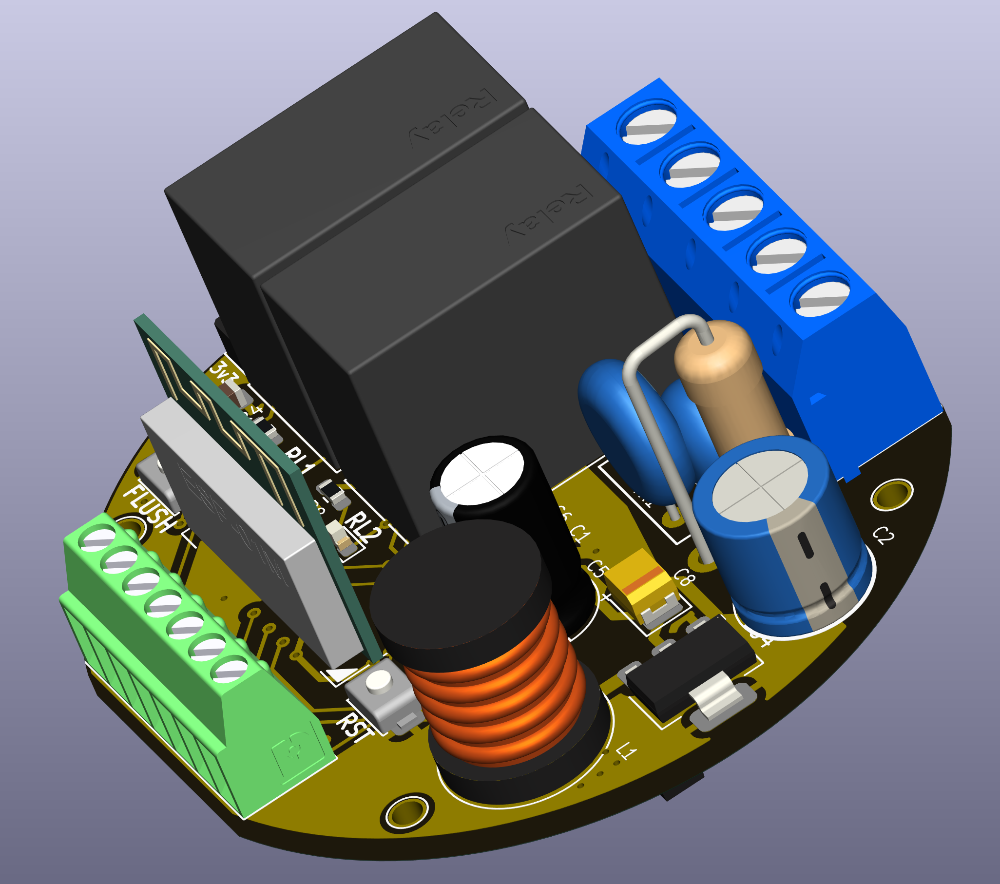

# SMHome 2RelayBoardRound ESP-01M — версия 7.1

Круглая двухрелейная плата управления рольставнями и другими механизмами с двумя направлениями движения. Контроллер — **ESP-01M на ESP8285** (семейство ESP8266, встроенная Flash 1 МБ). Плата рассчитана на размещение в закрытом корпусе, в том числе за настенным выключателем при достаточном месте и соблюдении требований электробезопасности.

Проект содержит схему, двухслойную печатную плату и локальные библиотеки KiCad. Прошивка в репозиторий не входит. Названия основных файлов сохраняют суффикс `_v7`; текущая ревизия проекта и маркировка на плате — **7.1**.

## Основные узлы

- **U1 ESP-01M:** Wi-Fi и управление входами/реле.
- **RL1/RL2 RJ-SS-105DM1:** два независимых нормально разомкнутых реле с катушками 5 В.
- **Q1/Q2 BC817:** ключи катушек; D1/D2 подавляют выбросы при отключении, D4/D5 показывают включение реле.
- **U2 BP2525F:** безразвязочный сетевой понижающий преобразователь на 5 В.
- **U4 AMS1117-3.3:** стабилизатор питания логики на 3,3 В; большая площадка корпуса соединена с выходом, контакт 2.
- **B1:** сброс ESP. **B2:** GPIO0/вход в загрузчик при удержании во время сброса.
- **J2:** внешние кнопки/датчики, питание логики и выбираемый вход SW3/ADC.
- **J3:** UART для прошивки и диагностики.
- **JP3:** выбор подключения сигнала J2.2 к GPIO4/SW3 либо ADC.

Схема состоит из трёх листов:

| Файл | Содержимое |
|---|---|
| `SMHome_2RelayBoardRound_ESP1M_v7.kicad_sch` | ESP, кнопки, индикаторы, ключи и катушки реле |
| `PowerSupply.kicad_sch` | Сетевой вход, защита, источник питания и силовые подключения |
| `ExtConnectors.kicad_sch` | Внешние входы, фильтры, защита и перемычка ADC |

## Питание и безопасность

**Источник на BP2525F не имеет гальванической развязки от сети.** GND платы соединена с минусом выпрямительного моста DB1. Обозначения 3,3 В и 5 В относятся к этой GND и не означают безопасное изолированное напряжение.

- J4.1 — логическая GND, **не защитное заземление PE**. Не использовать этот контакт для защитного проводника двигателя.
- Внешние устройства на J2 и программатор на J3 должны учитывать сетевой потенциал платы. Непосредственно подключать обычный USB-UART или заземлённый осциллограф при сетевом питании нельзя.
- Для обычной прошивки полностью отключить плату от L/N и других сетевых цепей и питать логику от изолированного источника 3,3 В.
- F1 находится только в ветви источника питания. Силовой ток двигателя через него не проходит; защита двигателя и силовой проводки должна обеспечиваться отдельно.
- Контакты реле имеют паспортный номинал 10 А/250 VAC для резистивной нагрузки. Это не допустимый ток произвольного двигателя: необходимо учитывать пусковой ток, моторный рейтинг реле и требования привода.

## Силовой разъём J4

| Контакт | Сеть | Назначение |
|---|---|---|
| 1 | GND | Общий провод электроники, не PE |
| 2 | N | Нейтраль сети |
| 3 | L | Фаза сети и питание общих цепей контактов реле |
| 4 | RL2 | Фаза через нормально разомкнутый контакт RL2 |
| 5 | RL1 | Фаза через нормально разомкнутый контакт RL1 |

**Аппаратной взаимной блокировки направлений в этой схеме нет.** Независимое включение RL1 и RL2 позволяет подать фазу на оба выхода одновременно. Перед применением с реверсивным приводом необходимо решить аппаратную блокировку. Прошивка также должна запрещать одновременное включение, отключать реле перед реверсом, выдерживать требуемую приводом паузу и ограничивать время движения.

## Управление и внешние входы

| Функция | GPIO ESP | Контакт модуля U1 |
|---|---:|---:|
| Реле RL1 | GPIO5 | 13 |
| Реле RL2 | GPIO12 | 14 |
| SW1 | GPIO10 | 12 |
| SW2 | GPIO16 | 17 |
| SW3 | GPIO4 | 10 |
| SN1 | GPIO14 | 15 |
| SN2 | GPIO13 | 5 |
| Индикатор D3 | GPIO9 | 11 |
| Кнопка B2 / загрузчик | GPIO0 | 8 |
| Аналоговый вход | ADC | 16 |

| Контакт J2 | Подключение |
|---|---|
| 1 | Не подключён |
| 2 | SW1 через R11; дополнительно SW3 либо ADC через R26 и JP3 |
| 3 | SW2 через R12 |
| 4 | SN1 через R13 |
| 5 | SN2 через R15 |
| 6 | +3V3 |
| 7 | GND |

SW2 перенесён с GPIO2 на GPIO16 (контакт 17 модуля), SN1 — с GPIO15 на GPIO14 (контакт 15). GPIO2 и GPIO15 больше не связаны с этими внешними входами; состояния датчиков на SW2 и SN1 не задают загрузочный режим ESP через эти выводы.

У GPIO16 нет внутренней подтяжки вверх. Если SW2 подключается к кнопке, замыкающей на GND, или к выходу с открытым стоком, нужна внешняя подтяжка к +3V3, например 10 кОм. В текущей схеме такая подтяжка SW2 не установлена. При активном выходе датчика необходимость подтяжки зависит от его схемы. В ESP8266 Arduino Core GPIO16 не поддерживает `attachInterrupt`: состояние кнопки следует опрашивать программно. [Документация ESP8266 Arduino Core](https://arduino-esp8266.readthedocs.io/en/latest/reference.html).

### JP3 и делитель ADC

- Замкнуты **1–2:** J2.2 подключён через R26 к SW3/GPIO4.
- Замкнуты **2–3:** J2.2 подключён через R26 к ADC.
- Одновременно замыкать оба положения не следует.

В версии 7.1 **R26 = 3 кОм, R27 = 1 кОм**. Для источника напряжения с малым выходным сопротивлением:

```text
J2.2 ── R26 3k ── JP3 2–3 ── ADC
                               │
                            R27 1k
                               │
                              GND

Uadc = Uin / 4
Uin = Uadc × 4
```

При 3,3 В на J2.2 получается 0,825 В на ADC; при 3,6 В — 0,900 В. Входное сопротивление делителя — 4 кОм. Даже с допусками обоих резисторов ±5% максимальное расчётное напряжение ADC при входных 3,6 В составляет около 0,969 В, ниже паспортной полной шкалы 1 В.

J2.2 одновременно связан со SW1/GPIO10 через R11. В режиме ADC этот GPIO должен быть входом без подтяжек. Указанные номиналы рассчитаны для измерения напряжения; их нельзя автоматически применять к токовому датчику или трансформатору без проверки его параметров. Эти значения рассчитаны, а не измерены на собранной плате.

## UART J3

| Контакт | Сигнал |
|---|---|
| 1 | GND |
| 2 | RX ESP, соединить с TX адаптера |
| 3 | TX ESP, соединить с RX адаптера |
| 4 | +3V3 |

Использовать логические уровни 3,3 В. Для входа в загрузчик удерживать B2/GPIO0 и выполнить сброс B1. Требования к изоляции и отключению сетевого питания приведены выше.

## Открытие проекта и библиотеки

Открыть `SMHome_2RelayBoardRound_ESP1M_v7.kicad_pro` в **KiCad 10**. Текущие сохранённые файлы используют формат KiCad 10.

Схема и плата используют стандартные библиотеки KiCad и пользовательские библиотеки этого компьютера. Неиспользуемые копии библиотек в папке проекта удалены. Таблицы `sym-lib-table` и `fp-lib-table` подключают пользовательские библиотеки по следующим путям:

- Символы: `/Users/abel/Documents/KiCad/Symbols`.
- Посадочные места: `/Users/abel/Documents/KiCad/libs`.
- 3D-модели: `/Users/abel/Documents/KiCad/3DModels`, переменная KiCad `KIKAD_USER_3DMODELS`.

На другом компьютере пути пользовательских библиотек нужно настроить заново. Одного клонирования репозитория недостаточно для воспроизведения всей внешней библиотечной среды. Стандартные библиотеки KiCad также должны быть установлены.

## Изменения версии 7.1

- Обновлены сохранённые файлы схемы, платы и настройки проекта для KiCad 10.
- Для U4 используется посадочное место `SOT-223-3_TabPin2`, с теплоотводной площадкой на выходе +3V3.
- Делитель ADC изменён на R26 = 3 кОм и R27 = 1 кОм; номиналы совпадают на схеме и PCB.
- Добавлены таблицы пользовательских библиотек проекта.
- Ревизия в штампах и маркировка на B.SilkS приведены к 7.1.
- README описывает фактическую схему, распиновку и ограничения применения.

Каталоги `gerbers`, `plots`, `bom` и иллюстрации могут содержать результаты предыдущих ревизий. Они не считаются автоматически обновлёнными для 7.1. Перед изготовлением необходимо заново выполнить ERC/DRC и сформировать производственные файлы из актуального проекта. Существующие замечания проверки и безопасность готового изделия требуют отдельного устранения/подтверждения; версия 7.1 не означает завершённую проверку готовности к производству.

## Иллюстрация платы

Изображение из предыдущей ревизии, для общего представления о конструкции:


