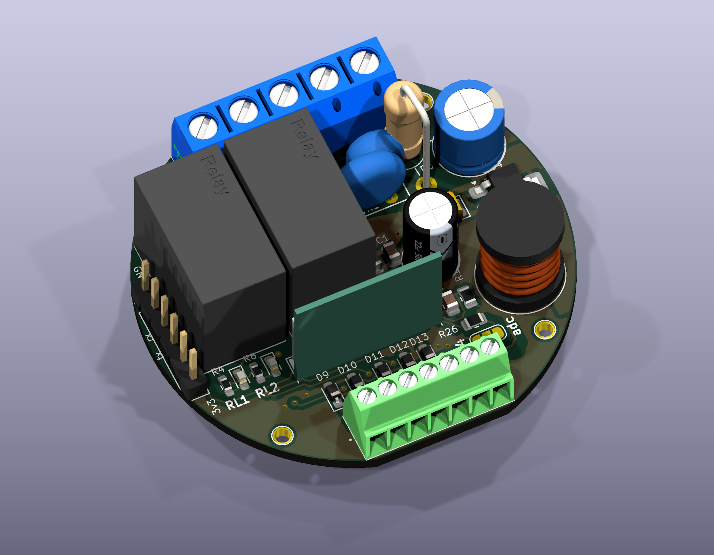
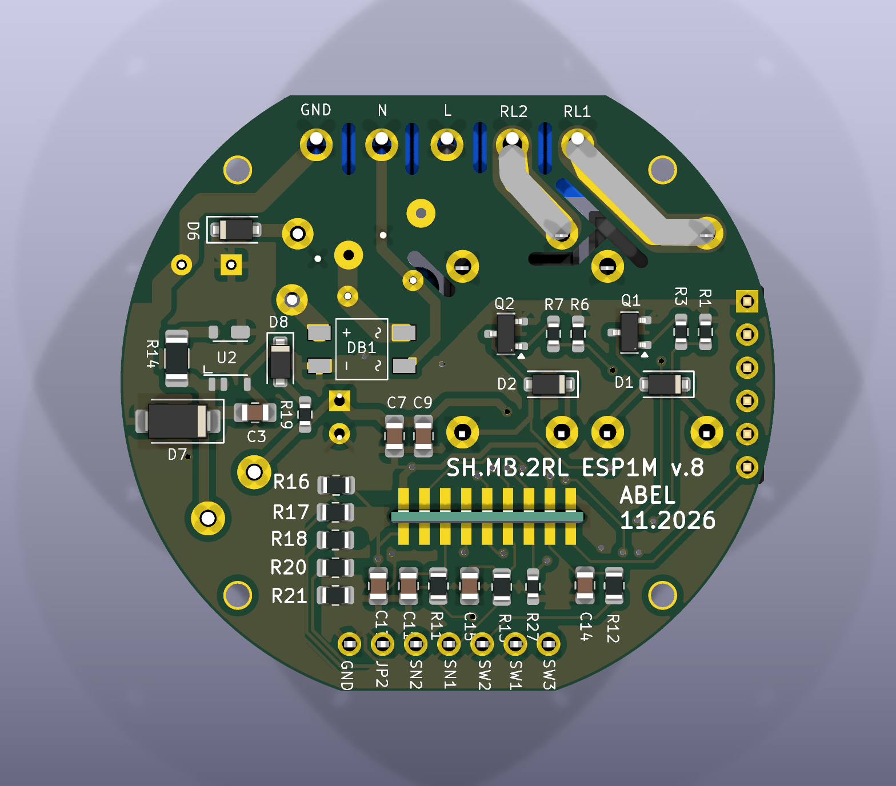

# SMHome 2RelayBoardRound ESP-01M — версия 8

**Русский** · [English](README.md)

Круглая двухслойная Wi-Fi-плата управления рольставнями: два релейных выхода, три входа настенных кнопок и два входа оконных герконов. Контроллер — **ESP-01M на ESP8285 со встроенной Flash 1 МБ**. Прошивка в репозиторий не входит.





Изображения получены рендерингом платы версии 8 в KiCad до последующих изменений DNP и монтажных отверстий; они показывают общий вид с установленными компонентами. Использованы доступные модели посадочных мест; некоторые корпуса отсутствуют или представлены приблизительными моделями. Эти изображения не заменяют проверку механических зазоров.

## Файлы проекта

Открыть `SMHome_2RelayBoardRound_ESP1M_v7.kicad_pro` в **KiCad 10**. Имена файлов сохраняют исторический суффикс `_v7`; актуальная версия в `VERSION`, штампах схемы/платы и маркировке платы — **8**.

| Файл | Содержимое |
|---|---|
| `SMHome_2RelayBoardRound_ESP1M_v7.kicad_sch` | Корневой лист: ESP, драйверы реле, индикаторы и разъём программирования |
| `PowerSupply.kicad_sch` | Защита сетевого входа, преобразователи питания и силовой разъём |
| `ExtConnectors.kicad_sch` | Кнопки/герконы, подтяжки, фильтры, защита и выбор ADC |
| `SMHome_2RelayBoardRound_ESP1M_v7.kicad_pcb` | Двухслойная печатная плата |

`MCU_STM32.kicad_sch` — старый файл, не входящий в иерархию текущего ESP-проекта. Существующие Gerber, plots, выгрузки BOM и старые изображения относятся к прежним состояниям; производственные файлы необходимо формировать заново из актуальных исходников.

## Описание схемы

### Питание

Сеть подключается через **J4**. **F1** защищает ветвь источника питания; **VR1 07D471K** включён между фазой после предохранителя и нейтралью. **DB1 MB8S** выпрямляет сетевое напряжение. **U2 BP2525F**, **L1 320 мкГн**, диоды и конденсаторы образуют неизолированный понижающий преобразователь **+5 В**. **R14 = 0,3 Ом** измеряет ток силового ключа. **C5 = 680 мкФ** — накопительный конденсатор выхода.

**U4 AMS1117-3.3** питает ESP и подтяжки входов от линии +5 В. Теплоотводная площадка SOT-223/контакт 2 соединена с **+3V3**, а не с GND. Медная площадка DRAIN микросхемы BP2525F относится к высоковольтной переключаемой цепи.

**Гальванической развязки от сети нет.** GND соединена с минусом выпрямительного моста. Обозначения 3,3 В и 5 В задают напряжение относительно этой GND и не означают безопасное изолированное питание. Соединять GND с защитным заземлением PE нельзя. Корпус, внешние выключатели, герконы, кабели и соединения должны обеспечивать изоляцию, подходящую для цепи, связанной с сетью. Малое напряжение между контактами не делает провода безопасными относительно земли.

### Релейные выходы

**RL1/RL2 RJ-SS-105DM1** имеют катушки 5 В и независимые нормально разомкнутые силовые контакты. **Q1/Q2 BC817** управляют катушками через базовые резисторы **R3/R7 = 1 кОм**. **R1/R6 = 10 кОм** подтягивают управляющие сигналы вниз. **D1/D2** подавляют выбросы при отключении катушек; **D4/D5** через **R4/R8 = 1 кОм** показывают включение реле.

Оба реле коммутируют фазу на отдельные выходы направлений двигателя. **Аппаратной взаимной блокировки в схеме нет**: оба выхода могут включиться одновременно. Для рольставней требуется подходящее решение блокировки. Прошивка также должна исключать одновременное включение, выдерживать необходимую приводу паузу перед реверсом и ограничивать время движения. Допустимость двигателя проверяют по пусковому току и характеристикам реле для индуктивной нагрузки; номинала для резистивной нагрузки недостаточно.

### Кнопки и оконные герконы

**SW1–SW3** — настенные кнопки; **SN1/SN2** — оконные герконы. Каждый внешний сухой контакт замыкает свой сигнал на **J2.7 / GND**. Подавать внешнюю фазу на J2 нельзя.

На всех пяти входах установлены **подтяжки 4,7 кОм к +3V3** и **конденсаторы 100 нФ на GND**: разомкнутый контакт = HIGH, замкнутый = LOW. Расчётный ток через замкнутый контакт — около **0,7 мА**; контакты выключателей должны надёжно работать с таким малым током.

| Вход | GPIO / контакт U1 | Подтяжка | Последовательный резистор | Конденсатор | Защитный диод |
|---|---|---|---|---|---|
| SW1 | GPIO10 / 12 | R17, 4,7 кОм | R11, 100 Ом | C11, 100 нФ | D10 |
| SW2 | GPIO16 / 17 | R18, 4,7 кОм | R12, 100 Ом | C14, 100 нФ | D11 |
| SW3 | GPIO4 / 10 | R16, 4,7 кОм | В цифровой ветви отсутствует | C17, 100 нФ | D9 |
| SN1 | GPIO14 / 15 | R20, 4,7 кОм | R13, 100 Ом | C15, 100 нФ | D12 |
| SN2 | GPIO13 / 5 | R21, 4,7 кОм | R15, 100 Ом | C16, 100 нФ | D13 |

**D9–D13 — PESD3V3L1BA.** Подтяжки R17/R18/R20/R21 стоят со стороны разъёма перед резисторами 100 Ом; R16 подключён непосредственно к SW3, со стороны GPIO относительно JP3. R26 относится только к ADC и не служит последовательным резистором кнопки SW3.

Для проводов около 2 м использовать отдельную витую пару на каждый контакт: **сигнал + GND схемы**. Изоляция кабеля должна подходить для цепи, связанной с сетью; категория Ethernet сама по себе этого не определяет. Прокладывать отдельно от силовых проводов двигателя и переключаемых сетевых цепей. В прошивке предусмотреть подавление дребезга, например подтверждение устойчивого состояния 20–50 мс. При внешних подтяжках использовать режим обычного входа без внутренней подтяжки. У GPIO16 внутренней подтяжки вверх нет; в ESP8266 Arduino его следует опрашивать, а не использовать через `attachInterrupt`.

Если геркон замкнут при закрытом окне, открытие окна и обрыв провода одинаково дадут HIGH. Контроля целостности шлейфа с различением этих событий в схеме нет.

### Монтажные отметки и отверстия

Выводные компоненты **C2, C5, F1, J2, J3, J4, L1, R5, RL1, RL2 и VR1** отмечены **«Не устанавливать» (DNP)** в схеме и на плате. Они сохраняются в электрической схеме, но текущая монтажная отметка исключает их установку.

Прежние TP2–TP5 заменены на **H1–H4** — монтажные отверстия **1,8 мм без металлизации**, с сохранением центров. Электрических выводов у них нет; они исключены из BOM и файла установки компонентов. Посадочное место включено в `Mechanical_Local.pretty` и подключено через `${KIPRJMOD}`.

## Разъёмы

### J2 — кнопки, герконы и выбираемый вход ADC

| Контакт | Назначение |
|---:|---|
| 1 | SW3 либо ADC, выбор JP3 |
| 2 | SW1 |
| 3 | SW2 |
| 4 | SN1 |
| 5 | SN2 |
| 6 | +3V3 |
| 7 | GND, общий провод контактов; не PE |

### JP3 — выбор цифрового/аналогового режима

- **Замкнуты 1–2:** J2.1 соединён со SW3/GPIO4. R16 подтягивает вход вверх, кнопка замыкает его на GND.
- **Замкнуты 2–3:** J2.1 подключён к ADC через R26. R16 и C17 остаются в отключённой от разъёма ветви GPIO4.
- Одновременно замыкать оба положения нельзя.

```text
J2.1 ── JP3 2–3 ── R26 3 кОм ──┬── ADC (U1.16)
                                │
                             R27 1 кОм
                                │
                               GND
```

Для источника напряжения с малым выходным сопротивлением **Uadc = Uin / 4**. Входное сопротивление делителя около 4 кОм: при 3,3 В на входе получается 0,825 В на ADC; при 3,6 В — 0,900 В. С допусками резисторов ±5% максимальное расчётное напряжение ADC при входных 3,6 В составляет около 0,969 В. Это расчёты, не измерения и не результаты моделирования. Диапазон ADC ESP — 0–1 В. Вход не предназначен для прямого измерения сети или подключения токового трансформатора без согласующей цепи.

### J3 — программирование и сброс, уровни 3,3 В

| Контакт | Сигнал |
|---:|---|
| 1 | GND |
| 2 | +3V3 |
| 3 | RX ESP; подключить TX адаптера |
| 4 | TX ESP; подключить RX адаптера |
| 5 | Flash / GPIO0, U1.8 |
| 6 | NRST, U1.18; активный LOW |

Прежние кнопки сброса и загрузчика на плате удалены. Для входа в загрузчик удерживать GPIO0 на LOW, кратковременно подать LOW на NRST, затем отпустить сброс и GPIO0. Ориентироваться на номера контактов в таблице: старая надпись `3v3` рядом с разъёмом не перенесена под расширенную распиновку.

**Перед программированием отключить все сетевые подключения** и питать логику от изолированного источника 3,3 В. Подключать обычный USB-UART или осциллограф с заземлённым общим проводом при наличии сетевого питания нельзя.

### J4 — сеть и двигатель

| Контакт | Сеть | Назначение |
|---:|---|---|
| 1 | GND | Общий провод электроники; не защитное заземление |
| 2 | N | Нейтраль сети |
| 3 | L | Фаза сети и питание контактов реле |
| 4 | RL2 | Фаза через контакт реле RL2 |
| 5 | RL1 | Фаза через контакт реле RL1 |

F1 защищает только ветвь питания платы; ток двигателя через контакты реле через него не проходит. Защита двигателя и силовой проводки должна обеспечиваться отдельно.

### GPIO управления реле

| Функция | GPIO | Контакт U1 |
|---|---:|---:|
| RL1 | 12 | 14 |
| RL2 | 5 | 13 |

GPIO2 и GPIO15 не используются для внешних контактов. Прошивка должна соответствовать версии 8, включая SW2 на GPIO16, и использовать настройки Flash, совместимые с работой GPIO10 на данном модуле.

## Библиотеки и 3D-модели

Используются стандартные библиотеки KiCad и пользовательские библиотеки из `sym-lib-table` и `fp-lib-table`. Сейчас таблицы содержат абсолютные локальные пути; на другом компьютере их нужно настроить заново. Подключить пользовательские символы/посадочные места и задать **`KIKAD_USER_3DMODELS`** (историческое написание) как каталог пользовательских 3D-моделей. Модель ESP также использует старый псевдоним пути 3D. Встроенные символы схемы и посадочные места платы сохраняют текущую конструкцию, но клонирование репозитория не устанавливает все библиотеки и модели для редактирования.

PNG-рендеры включены в репозиторий для просмотра платы на GitHub без установки библиотек. Старые `images/3dview.png` и `images/top.png` не являются иллюстрациями версии 8.

## Изменения версии 8 и состояние проверки

- Изменены состав компонентов и разводка; добавлены пять внешних подтяжек входов по 4,7 кОм.
- R26 перенесён исключительно в ветвь ADC; R16 подключён к SW3 и не смещает ADC в аналоговом режиме.
- Разделены SW1 и выбираемый SW3/ADC; J3 расширен до шести контактов для программирования и сброса.
- Удалены кнопки сброса/загрузчика и отдельный индикатор GPIO9; обновлено назначение GPIO реле.
- Обновлены штампы и маркировка платы до версии 8; добавлены два README и актуальные 3D-рендеры.

Проверки сохранённого проекта выполнены в KiCad 10.0.8 **18 ноября 2026 года**:

| Проверка | Результат |
|---|---|
| Состав схемы | 64 символа, включая разъёмы и четыре монтажных отверстия |
| DRC после пересчёта заливок | 0 ошибок, 56 предупреждений; 0 неразведённых соединений |
| Соответствие платы схеме | 0 замечаний |
| ERC | 10 ошибок, 349 предупреждений |

Минимальное число термоспиц для платы теперь равно 1; у J2.7 задан локальный зазор термобарьера 0,25 мм. Предупреждения DRC: 28 расхождений посадочных мест с библиотеками, 21 нарушение отступа шелкографии от края и 7 изолированных участков меди. ERC содержит неподключённые выводы, несовпадение иерархического вывода листа `AC_SENS`, конфликт типов выводов и замечания к питанию; большинство предупреждений относятся к концам соединений вне сетки и расхождениям символов с библиотеками. Надпись `JP2` у J2.6 осталась от старого обозначения; этот контакт подключён к +3V3.

**Версия 8 фиксирует состояние разработки и не означает готовность к производству или подтверждённую электробезопасность.** Перед изготовлением и работой от сети требуется устранить/проверить оставшиеся электрические и конструктивные замечания, блокировку направлений, внешнюю изоляцию и размещение в корпусе. При обновлении документации измерения на собранной плате, новые SPICE-симуляции и полная проверка соответствия нормам не выполнялись.
